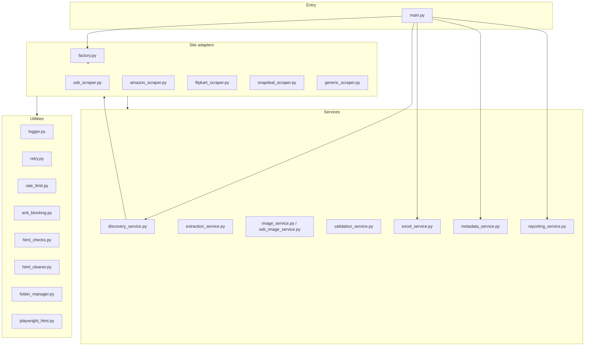

# Technical documentation — Enterprise web ingestion POC

This document explains **what this project does**, **which technologies it uses**, **how each major part is implemented**, and **which techniques address reliability, blocking, and CAPTCHA-related pages**. It is written so a reader with no prior context can understand the system end to end.

---

## Table of contents

1. [Purpose and scope](#1-purpose-and-scope)
2. [High-level architecture](#2-high-level-architecture)
3. [Technology stack](#3-technology-stack)
4. [Execution flow (from user input to outputs)](#4-execution-flow-from-user-input-to-outputs)
5. [Site handlers and discovery strategies](#5-site-handlers-and-discovery-strategies)
6. [Product page extraction](#6-product-page-extraction)
7. [Images: discovery, roles, and downloads](#7-images-discovery-roles-and-downloads)
8. [HTML storage: raw vs clean](#8-html-storage-raw-vs-clean)
9. [Anti-blocking and polite crawling](#9-anti-blocking-and-polite-crawling)
10. [CAPTCHA and bot-wall handling](#10-captcha-and-bot-wall-handling)
11. [Retries and fault isolation](#11-retries-and-fault-isolation)
12. [Validation (current vs future)](#12-validation-current-vs-future)
13. [Reporting and outputs](#13-reporting-and-outputs)
14. [Configuration](#14-configuration)
15. [Operational notes (scale, runtime, ethics)](#15-operational-notes-scale-runtime-ethics)
16. [How to run](#16-how-to-run)

---

## 1. Purpose and scope

### What problem this solves

Organizations often need **structured product data** from public reseller sites: titles, references, prices, specifications, images, and HTML evidence of what was seen at crawl time. This project is a **proof-of-concept (POC) ingestion pipeline** that:

- Accepts a **campaign-style query label** and one or more **site URLs**
- **Discovers** product detail page (PDP) URLs up to a configurable cap
- **Extracts** structured fields and downloads images
- **Stores** raw HTML, cleaned HTML, JSON per product, and enterprise-style spreadsheets and JSON reports
- **Logs** progress and failures without stopping the whole run when one URL fails

### Primary vs secondary targets

| Priority | Sites | Role in POC |
|----------|--------|----------------|
| Primary | **https://www.seb.fr/** (Groupe SEB France, Hybris storefront) | Full category crawl, large-scale URL discovery, rich PDP schema |
| Secondary | **Amazon.in**, **Flipkart**, **Snapdeal** | Search-based discovery + marketplace-specific PDP parsing (India-focused defaults in browser context) |
| Extension point | **Generic scraper** | Any unknown host gets a stub implementation so the architecture shows where to plug a new marketplace |

---

## 2. High-level architecture

The codebase follows a **layered, modular** layout:



**Design intent:**

- **`scraper/`** — One class per marketplace (`BaseScraper` abstract interface). Adding a site means implementing `discover_urls` + `scrape_product` and registering the host in `factory.py`.
- **`services/`** — Cross-cutting concerns: Excel normalization, run metadata, coverage/error JSON, HTML bundle persistence, validation hooks.
- **`utils/`** — Shared mechanics: logging, retries, delays, Playwright stability helpers, CAPTCHA heuristics, HTML cleaning.

---

## 3. Technology stack

Mandatory stack (see `requirements.txt`):

| Component | Package | Role |
|-----------|---------|------|
| Language | **Python 3.10+** | Runtime |
| Browser automation | **Playwright** (`playwright>=1.40.0`) | Headless Chromium; navigates listings and PDPs; renders JS-heavy pages |
| HTML parsing | **BeautifulSoup4** + **lxml** | DOM traversal, selector-based extraction, regex-assisted passes |
| HTTP downloads | **requests** | Image downloads with controlled headers (e.g. Referer) |
| Optional HTTP | **httpx** | Available for future async or alternate HTTP paths (listed in requirements) |
| Tabular reporting | **pandas** + **openpyxl** | `master_index.xlsx`, `failed_products.xlsx`, legacy root `index.xlsx` |
| Configuration | **dataclasses** (`config.py`) | Immutable `ScraperConfig`; CLI overrides via `dataclasses.replace` |

**Playwright browser install** (one-time per machine):

```bash
playwright install chromium
```

---

## 4. Execution flow (from user input to outputs)

1. **Parse CLI or interactive prompts** — Query string, comma-separated site URLs, optional `--max-products`, optional EAN file path.
2. **Generate a run ID** — UUID `extraction_run_id` for correlating metadata and Excel rows.
3. **Create run folder** — `output/run_YYYYMMDD_HHMMSS/` (suffix `_1`, `_2`, … if collision).
4. **Configure logging** — `logs/scraper.log` under the run folder; logger name `enterprise_ingestion`.
5. **For each site URL:**
   - Resolve **hostname → folder label** (e.g. `www.seb.fr` → `seb.fr`).
   - **Factory** returns the appropriate scraper class instance (or `GenericScraper` for unknown hosts).
   - Create a **fresh Playwright browser context** with:
     - **Random User-Agent** from a small pool (`utils/anti_blocking.py`)
     - **Locale / timezone** suited to the site (e.g. `fr-FR` + `Europe/Paris` for SEB; `en-IN` + `Asia/Kolkata` for Indian marketplaces)
   - **Discovery phase** — `discover_urls(...)` fills a list of PDP URLs up to `max_products`.
   - **Extraction phase** — For each PDP: create `product_000001`-style folder, call `scrape_product`, normalize row to master columns, append errors if status ≠ OK.
   - **Close context** — Isolates cookies/storage between sites.
6. **Aggregate reporting** — `coverage_report.json`, `error_report.json`, enhanced `metadata.json`.
7. **Excel** — `excel/master_index.xlsx`, `excel/failed_products.xlsx`, plus optional root `index.xlsx` snapshot.

---

## 5. Site handlers and discovery strategies

### 5.1 Groupe SEB (`seb.fr`) — category breadth-first + pagination

**Goal:** Collect hundreds of PDP URLs without relying on a single search box.

**Techniques:**

1. **Homepage load** — Playwright navigates the root URL, waits for load, uses **`get_stable_html`** (`utils/playwright_html.py`) to avoid race conditions when reading `page.content()` during navigation.
2. **Extract category links** — Links whose path contains **`/c/`** (Hybris category hubs) are collected into a **queue** (`scraper/seb_parse.py`: `extract_category_urls`).
3. **Breadth-first expansion** — Each visited listing page can enqueue **new** category URLs discovered on that page (subcategories).
4. **Listing pagination** — For each category base URL, the scraper requests **`?page=2`**, **`?page=3`**, … up to `seb_max_pages_per_category` (from `config.py`). If consecutive pages add **no new PDPs**, pagination stops early for that hub.
5. **PDP URL normalization** — Only URLs matching Hybris-style paths with **`…/<segments>/p/<numeric_id>`** are kept; bare `/p/<id>` or malformed hosts are rejected to avoid broken navigations (`normalize_pdp_url`, `_path_is_valid_pdp`).
6. **Dedup** — A `seen` set ensures unique PDP URLs.
7. **Caps** — Discovery stops when `max_products` URLs are collected or category visit budget (`seb_max_category_visits`) / listing pagination limits are hit.

### 5.2 Amazon.in — search SERP discovery

**Techniques:**

- Build search URLs from `build_search_url` (`config.py`).
- Paginate until enough URLs or no new ASINs / page cap (`scraper/discovery.py`).
- Normalize PDP links to canonical **`/dp/<ASIN>`** on the configured marketplace host; regex fallback on raw HTML and **`[data-asin]`** attributes when DOM selectors miss tiles.

### 5.3 Flipkart — search + `/p/itm` links

**Techniques:**

- Construct `/search?q=…` URLs with pagination.
- Normalize PDP URLs containing **`/p/itm`** (`scraper/flipkart_scraper.py`).
- Filter promo/non-gallery image URLs in image extraction layer (`services/image_service.py`) so downloads target real product CDN paths.

### 5.4 Snapdeal — similar search/listing discovery

**Techniques:**

- Search URL builder + PDP pattern matching (`scraper/snapdeal_scraper.py`).

### 5.5 Generic scraper — extension point

**Techniques:**

- **`GenericScraper`** implements the same interface but returns **no discovery URLs** and an **ERROR**-style row for PDP calls — demonstrates where a new marketplace adapter would be coded (`scraper/generic_scraper.py`).

---

## 6. Product page extraction

### 6.1 Playwright navigation

- **`_goto`** (per scraper) uses **`@retry_with_backoff`** — navigations that fail transiently are retried with exponential backoff + jitter (`utils/retry.py`).
- After navigation, **`get_stable_html`** waits for load state and retries `page.content()` when Playwright reports navigation races.

### 6.2 SEB PDP parsing (`scraper/seb_parse.py`)

**Techniques:**

| Data | Method |
|------|--------|
| Title | `h1`, fallback `og:title` |
| Brand | `meta` (`product:brand`, `og:site_name`), normalized to **SEB** when appropriate |
| Reference | Regex on title/HTML for codes like **`AH960800`** |
| EAN | Regex on visible text for GTIN-like patterns when present |
| Price | Sniff `"price":…` in embedded analytics JSON; fallback **`Prix`** row in specification tables; euro text regex |
| Specifications | Table `tr` / `dl` key-value pairs |
| Short / long description | Meta description + consolidated text from product description containers |
| Breadcrumbs | Nav / `.breadcrumb` lists + URL-derived category fallback |
| Availability | French keywords (**en stock**, **rupture**, etc.) + light meta |
| Images | Collect **`/medias/?context=…`** Hybris media URLs + `og:image`; filter icon/nav junk |

Structured output for SEB is written to **`data.json`** including **`sellers: []`** as a placeholder for future multi-seller extraction on this storefront.

### 6.3 Marketplace scrapers

Amazon / Flipkart / Snapdeal use site-specific BeautifulSoup selectors and helper modules (`scraper/product.py`, `scraper/images.py`, `scraper/sellers.py` where applicable).

---

## 7. Images: discovery, roles, and downloads

### SEB (`services/seb_image_service.py`)

1. **Ordering** — URLs collected from HTML in discovery order; **`assign_image_roles`** maps position to **`main`**, **`secondary`**, **`detail`**, **`lifestyle`** (heuristic bands).
2. **Filenames** — **`main_01.jpg`**, **`secondary_01.jpg`**, … per role counters (enterprise naming requirement).
3. **HTTP** — **`requests`** GET with **`Referer: https://www.seb.fr/`** and desktop-like **`User-Agent`**.
4. **Retries** — Each download wrapped in **`retry_with_backoff`**.
5. **JSON** — Each saved image records **`url`**, **`local_path`**, **`image_role`**, **`image_index`**.

### Other sites (`services/image_service.py`)

Image URLs are extracted per marketplace rules; files may use sequential **`imgN.ext`** naming depending on handler — normalization in Excel still reports **`image_count`** and **`main_image_path`** when the scraper provides them.

---

## 8. HTML storage: raw vs clean

**Raw:** Full rendered HTML after Playwright load — saved as **`raw.html`** (SEB path).

**Clean:** **`utils/html_cleaner.py`** removes scripts, styles, common chrome (`nav`, `header`, `footer`, iframes, etc.) and strips inline event handlers — saved as **`clean.html`** for archival readability. This is **not** a security sanitizer for untrusted HTML execution contexts; it is for **storage and audit**.

Controlled by **`save_clean_html`** in `config.py`.

---

## 9. Anti-blocking and polite crawling

The project **does not** implement aggressive fingerprint spoofing or third-party CAPTCHA-solving services. It uses **ethical, low-impact** techniques:

| Technique | Where | What it does |
|-----------|--------|----------------|
| **Random delay between steps** | `utils/rate_limit.py` | `pause_between_requests(cfg)` sleeps a random duration in **`[delay_min_sec, delay_max_sec]`** (default 1.0–3.5s) |
| **User-Agent rotation** | `utils/anti_blocking.py` | Picks one of several **desktop Chrome / Edge** strings per **browser context** |
| **Browser context isolation** | `main.py` | **New context per site** — cookies and storage do not leak between domains |
| **Locale / timezone** | `main.py` | Matches region expectations (Europe vs India) to reduce anomalous signals |
| **Reasonable timeouts** | `config.py` | `navigation_timeout_ms` caps how long Playwright waits |
| **Referer on image GETs** | SEB image downloader | Some CDNs expect a site Referer |

Together, these reduce the chance of triggering rate limits and present traffic similar to ordinary browsing — **without** promising evasion of deliberate blocking.

---

## 10. CAPTCHA and bot-wall handling

### Philosophy

- **Detect** interstitial / challenge pages.
- **Do not** bypass CAPTCHAs programmatically (no external solving APIs, no “solver” plugins).
- **Mark** affected URLs as **`BLOCKED`** (or similar) and continue the pipeline.

### Detection (`utils/html_checks.py`)

**`page_contains_captcha(html)`** uses **multi-signal** substring checks tuned to **real** challenge pages, for example:

- Amazon-style robot checks and character challenges
- Cloudflare-style markers (`cf-browser-verification`, “checking your browser…”)
- Amazon validate/CVF fragments

**Important:** The detector **avoids** naive matches like the substring **`captcha` alone**, because legitimate pages (e.g. SEB newsletter widgets) may mention **reCAPTCHA** in scripts without showing a wall — those caused false positives during development and were deliberately excluded.

### Runtime behaviour

- On **discovery** or **PDP**, if HTML matches **`page_contains_captcha`**, the scraper:
  - Saves whatever HTML is safe to persist
  - Sets status **`BLOCKED`**
  - Optionally captures **`blocked.png`** / **`failure.png`** when **`save_screenshot_on_failure`** is enabled (SEB scraper)
- Events are listed in **`error_report.json`** via the reporting service.

---

## 11. Retries and fault isolation

| Mechanism | Implementation |
|-----------|------------------|
| **Exponential backoff + jitter** | `retry_with_backoff` in `utils/retry.py` — used on navigations and HTTP image fetches |
| **Per-product isolation** | `scrape_product` is designed **not to raise** for normal failures; returns a row with **`ERROR`** / **`BLOCKED`** |
| **Per-site isolation** | `main.py` wraps each site in try/except; one site failing does not abort others |
| **Scrape duration** | Recorded per product (`scrape_duration_seconds`) for Excel and auditing |

---

## 12. Validation (current vs future)

### Current (POC)

- **`validation_service.py`** supports:
  - **Fallback mode**: brand / keyword style checks when **`enforce_product_validation`** is **False** (default), most products are scraped fully.
  - Optional **EAN dataset** loading from JSON/CSV/txt — populates **`VALID_EANS`** when a file path is provided.
- **`enforce_product_validation`** when **True** can restrict deep extraction (e.g. images) for rows that fail rules — marketplace scrapers integrate this gate.

### Future

- Plug-in **EAN/SKU allowlists** and stricter rules without changing folder layout — dataset path is already in config.

---

## 13. Reporting and outputs

| Artifact | Description |
|----------|-------------|
| **`metadata.json`** | Run envelope: `extraction_run_id`, timestamps, duration, CLI summary, sites, validation mode, **`coverage`** snapshot |
| **`coverage_report.json`** | Counts: discovered vs attempted, OK / blocked / errors / filtered, ratios |
| **`error_report.json`** | Structured list of non-OK events (site, URL, failure type, timestamp) |
| **`excel/master_index.xlsx`** | Normalized enterprise columns (extraction id, timestamps, site, product, price, media paths, durations, …) |
| **`excel/failed_products.xlsx`** | Subset of rows where status ≠ OK |
| **`index.xlsx`** (root) | Legacy-compatible duplicate of master columns |
| **Per product** | `raw.html`, `clean.html` (if enabled), `data.json`, `images/` |

---

## 14. Configuration

All tunables live in **`config.py`** (`ScraperConfig`):

| Area | Examples |
|------|-----------|
| Volume | `max_products`, `max_search_pages`, `seb_max_category_visits`, `seb_max_pages_per_category` |
| Politeness | `delay_min_sec`, `delay_max_sec` |
| Robustness | `navigation_timeout_ms`, `max_retries`, `image_download_timeout_sec` |
| Export | `product_id_padding`, `save_clean_html`, `save_screenshot_on_failure`, `excel_subdir` |
| Validation | `validation_mode`, `ean_dataset_path`, `enforce_product_validation` |

CLI **`--max-products`** overrides default `max_products` for that run.

---

## 15. Operational notes (scale, runtime, ethics)

- **Large runs** (500–1000+ PDPs) can take **tens of minutes to hours** because of **deliberate delays**, retries, image downloads, and page complexity.
- **Memory** is dominated by HTML strings and Playwright; the design favours **sequential** PDP processing for stability over aggressive parallelism in this POC.
- **Legal / contractual**: crawling must comply with site terms, robots policies where applicable, and organisational approval. This POC is for **authorised** environments.

---

## 16. How to run

**Non-interactive (recommended for demos):**

```bash
pip install -r requirements.txt
playwright install chromium
python main.py -y -q "my-campaign" -s "https://www.seb.fr" --max-products 500
```

**Interactive:**

```bash
python main.py
```

Follow prompts for query, comma-separated URLs, and product cap.

---

## Document maintenance

When adding a marketplace or changing discovery/extraction, update:

- `scraper/factory.py` — registration
- This file — discovery and extraction sections
- `README.md` — quick start if behaviour or CLI changes

---

*Generated to describe the repository implementation as of the last codebase snapshot. Behaviour is defined by the code in `main.py`, `config.py`, and the `scraper/`, `services/`, and `utils/` packages.*
